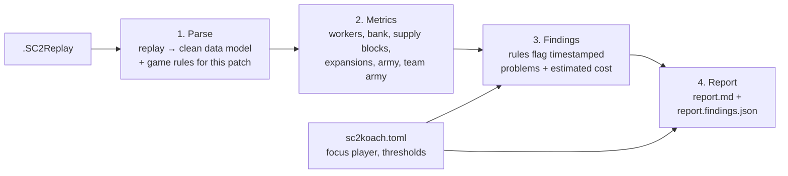

# How sc2Koach works

This page explains what a StarCraft II replay actually contains, how sc2Koach turns it into numbers, and what it can and cannot see. Read it once; it makes the report much easier to trust and question.

- [What is in a replay](#what-is-in-a-replay)
- [The pipeline](#the-pipeline)
- [Step 1: Parse](#step-1-parse)
- [Step 2: Metrics](#step-2-metrics)
- [Step 3: Findings](#step-3-findings)
- [Step 4: Report](#step-4-report)
- [Game patches change the rules](#game-patches-change-the-rules)
- [What sc2Koach cannot see](#what-sc2koach-cannot-see)
- [Glossary](#glossary)

---

## What is in a replay

A `.SC2Replay` file is **not a video**. It is the list of commands every player issued, plus a few logs the game writes while it runs. When you watch a replay, the game re-simulates the match from those commands. sc2Koach doesn't re-simulate; it reads three logs the game already wrote:

| Log | What it holds | How sc2Koach uses it |
|---|---|---|
| **Stats snapshots** (`PlayerStatsEvent`) | Every **7.14 seconds** of game time, for each player: minerals and gas in the bank, income per minute, supply used and supply cap, worker count, army value, army value lost and killed so far | The backbone of almost every metric. These numbers come from the game itself, so they're exact at each snapshot |
| **Unit events** (tracker) | Every unit or building born, started, finished, died, or changed type (e.g. Command Center → Orbital), with positions for born/started/died | Supply cap between snapshots, town hall locations (expansions), who still has buildings (elimination), army estimates for players who left |
| **Commands and player events** | Each player's clicks and abilities; leaving the game; sending resources to an ally | When a player left, where a flying Command Center landed, Calldown: Extra Supplies, resource trades |

### Time

The replay counts time in **game loops**: 22.4 per second at "Faster" speed (the ladder speed). sc2Koach converts everything to **real seconds matching the in-game clock**, so a moment the report puts at `6:42` is at 6:42 on the replay timer. You can jump straight there.

Snapshots are taken every 160 loops (7.14s). Anything measured from snapshots is precise *at* a snapshot, but sc2Koach can't say exactly what happened between two of them. That's why, for example, supply-block durations are reported as "at least N seconds".

### What the numbers mean

- **Bank:** minerals + gas you're holding and haven't spent.
- **Income:** minerals + gas gathered per minute (the game's own collection rate).
- **Supply used / cap:** the numbers at the top of your screen (e.g. `44/52`). Supply used **includes units currently in production**, exactly like the in-game counter.
- **Workers:** SCVs, Probes and Drones. MULEs are excluded, as in the game's worker count.
- **Army value:** total mineral + gas cost of your living army units (the same number as the in-game Army panel).
- **Army lost / killed:** running totals of army value you lost and destroyed.

---

## The pipeline

Every step is **deterministic**: the same replay and settings always give byte-identical output. Nothing is guessed by an AI; every sentence in the report is generated from a measured number.

---

## Step 1: Parse

`sc2koach.parser` reads the replay with the open-source [`sc2reader`](https://github.com/ggtracker/sc2reader) library and builds a clean `ReplayModel`:

- **Game:** map, duration, game build, ladder or not, mode (2v2/3v3).
- **Teams and players:** names, race, MMR (when the replay has it), lobby slot, Battle.net ID (toon handle), result.
- **Snapshots, unit events, trades, Land commands, Extra Supplies casts.**
- **When each player stopped playing:** `left_at` (quit) and `eliminated_at` (last building destroyed). A player's **end time** is the earlier of the two, or the end of the game. Per-player metrics stop there, so a player who quit at 8:00 isn't blamed for anything after 8:00.
- **Counterparts:** each player is paired with the player in the same lobby position on the other team. This is a *convention* ("nominal counterpart"): a replay can't tell who actually fought whom. It's used for side-by-side context only, never to trigger a finding.

**Rejected replays** (exit code 2): 1v1, free-for-all, uneven teams, archon mode, games with AI players, and games under 60 seconds (remakes). 4v4 is analyzed with a warning (thresholds were tuned for 2v2/3v3).

**Self-checks:** the parser rebuilds the supply cap and worker count from unit events and compares them with the game's snapshots. On your 365 replays they agree 99.7%+ of the time. If a replay falls below 95% (cap) or 99% (workers), the report warns `game_data_drift` and the affected calculations fall back to snapshot-only data.

---

## Step 2: Metrics

`sc2koach.metrics` computes, for every player:

| Metric | How it's measured |
|---|---|
| **Workers at 4:00** | Worker count from the last snapshot at or before 4:00 (3:56) |
| **Bank** (and mean, peak) | Minerals + gas at each snapshot. If an ally sent you resources in the last 20s, that amount is subtracted, so receiving a gift doesn't count as you floating money |
| **SQ (spending quotient)** | A standard score of how well you spend *relative to your income*: `35 × (0.00137 × income − ln(bank)) + 240`, using your averages over the game. Higher is better. Roughly: 50 = floating a lot, 70 = decent, 90+ = excellent |
| **Supply blocks** | Times you were at your supply cap (under 200), had a town hall, and had ≥ 50 minerals (so you could have built at least a worker). The block ends when a depot/pylon/overlord finishes or the next snapshot shows room |
| **Expansions** | Each town hall finished (or Command Center landed) **more than 15 map units from every town hall location you've ever had**. Morphs (Orbital, Planetary, Lair, Hive), in-base Command Centers, macro Hatcheries and rebuilding a lost base don't count. Base 1 is your main, 2 your natural, 3 your third |
| **Army value**, lost, killed | From snapshots, until the player's end time |

And for every team:

| Metric | How it's measured |
|---|---|
| **Team army value** | Sum of the team's army values at each snapshot, including players who left. Their units stay on the field under ally control; if the game stops reporting their snapshots, sc2Koach estimates their army from unit events |
| **Army gap** | Your team's army value minus the enemy team's |
| **Eliminations** | Who left or was eliminated, when, and how long the rest of the team kept playing |

---

## Step 3: Findings

`sc2koach.moments` runs seven rules over the metrics. Each rule produces **findings**: a type, a player (or team), a time range, the evidence numbers, and an **estimated cost** in resources.

| Finding | One-line meaning |
|---|---|
| `supply_block` | You couldn't build because you were at your supply cap, and you had the money |
| `high_bank` | You held too many unspent resources for 30s or more |
| `low_workers` | You had fewer workers at 4:00 than the target for your race |
| `late_expansion` | Your second or third base finished late, or never |
| `army_collapse` | You lost most of your army in 30 seconds without trading well |
| `early_ally_death` | A teammate left or died and the rest of the team had to play a player down |
| `team_army_deficit` | Your team's army was far smaller than the enemy's for at least a minute |

The [findings guide](findings-guide.md) explains each one in depth, with what to do about it.

**Ranking.** Each finding gets a rough **estimated resource cost**, so different kinds of mistakes can be put in one ordered list. Findings are numbered `f-001`, `f-002`… in time order; the numbers are stable, so you can refer to them when you discuss a game. See [reading your report](reading-your-report.md#how-to-weigh-top-priorities) for an important caveat about the ranking.

---

## Step 4: Report

`sc2koach.report` writes two files side by side:

- **`<name>.md`**: the human-readable report ([section-by-section guide](reading-your-report.md)).
- **`<name>.findings.json`**: everything in machine-readable form: the replay summary, every metric series, every finding with its evidence, the thresholds used, and warnings. Useful for spreadsheets, scripts, or a future GUI.

The **focus player** (you, by default `blacksheep`) is written about as "you"; everyone else is in the third person. Any teammate can run the same replay with `--focus <their name>` to get the report from their point of view. The facts don't change, only the wording and order.

---

## Game patches change the rules

StarCraft II patches can change starting workers, unit costs, how much supply buildings give, and more. This already happened in your replays: on **build 97563**, players start with **8 workers**, and Command Centers and Nexuses give **13 supply** (Hatcheries **4**) instead of the usual 12 workers and 15/6 supply.

sc2Koach handles this by **reading, not assuming**:
- starting workers and supply are read from each replay's first snapshot;
- each replay gets a **ruleset id** describing its starting conditions, e.g. `w12-th15` (12 workers, town hall 15 supply) or `w8-th13`. It appears in the report header;
- the worker target adjusts automatically (−2 workers on the 8-worker ruleset);
- on a build newer than any it has been checked against, the report warns `unverified_build`.

Details: [DESIGN.md §4](../design/DESIGN.md#4-game-builds-and-rules).

---

## What sc2Koach cannot see

Be clear about the limits so you don't over-read the report:

- **Where fights happened and who fought whom.** It sees army value going down, not the battle. Counterparts are nominal (lobby slot).
- **Micro, positioning, unit composition and counters.** A collapse might be a bad engagement, a bad unit matchup, or a surprise attack. The finding tells you *when* to look; the replay tells you *why*.
- **Scouting, build orders, upgrades, APM, control groups, injects/chrono/MULE usage.** Planned for later phases.
- **Anything between snapshots** (7.14s apart) beyond what unit events show.
- **Intent.** Banking 2,000 minerals might be a deliberate save for a third base. The report flags it; you judge it.

---

## Glossary

| Term | Meaning |
|---|---|
| **Army value** | Total mineral + gas cost of a player's living army units |
| **Bank** | Unspent minerals + gas |
| **Counterpart (nominal)** | The opponent in the same lobby position as you; a pairing convention, not who you actually fought |
| **Early ally death** | A teammate leaving or being eliminated while the team keeps playing for at least 60s |
| **End time** | When a player stopped playing: left, eliminated, or the game ended |
| **Expansion / base** | A town hall at a new location. Main = base 1, natural = base 2, third = base 3 |
| **Finding** | A flagged, timestamped problem with evidence and an estimated cost |
| **Focus player** | Whose point of view the report takes ("you") |
| **Game loop** | The game's clock tick; 22.4 per second |
| **Income** | Minerals + gas gathered per minute |
| **Ruleset** | Starting conditions of a patch (e.g. `w12-th15`) |
| **Snapshot** | The game's own stats log for a player, every 7.14s |
| **SQ** | Spending quotient: how well you spend relative to your income. Higher is better |
| **Supply block** | Being at your supply cap with money to spend, so you can't build units |
| **Supply cap** | Maximum supply you can use right now (from depots/pylons/overlords/town halls), up to 200 |
